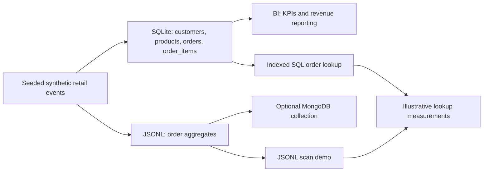

# Retail Data Architecture Lab

**A reproducible portfolio project connecting Business Intelligence, SQL modeling, aggregate-oriented NoSQL, and basic experimental methodology.**

> The retail dataset is entirely **synthetic**. The project compares data models, not universal database performance.

## What problem does this solve?

An online store needs reliable orders, fast retrieval of each order with its items, and analytical KPIs (revenue, AOV, monthly trends, and categories). Does an order make more sense across normalized relations or as an aggregate? How do transactional models support analytics?

## Architecture



### Data models

- **Relational (SQLite):** 4 normalized tables, foreign keys, constraints, indexes; order detail assembled via a JOIN.
- **Aggregate (JSONL):** one JSON document per order, with nested items and a `customer_id` reference; product metadata fields are deliberately copied into items as a modeling choice.
- **Optional real NoSQL (MongoDB):** import the same documents, create indexes, and run a document lookup.
- **BI reporting:** completed-order revenue, average order value (AOV), unique customers, repeat customers, cancellations, month and category revenue.

## Quick start (Python 3.10+)

```bash
python -m src.pipeline --customers 900 --orders 6500 --seed 42
python -m unittest discover -s tests -v
python -m src.benchmark
```

`src.pipeline` uses only the Python standard library for data/metrics. Plotting requires `matplotlib` (`pip install matplotlib`). Outputs are written to `outputs/`.

## Optional: run a real MongoDB collection

```bash
docker compose up -d
pip install pymongo
python -m src.mongo_optional
docker compose down
```

The Docker mapping binds MongoDB to **localhost**, not a public interface. This local demo has no authentication: never expose it on a public server.

## Example analytic questions

| Business question | Output |
|---|---|
| How much completed-order revenue did we earn? | `outputs/kpis.json` |
| How does revenue vary by month? | `outputs/monthly_revenue.csv` and `outputs/dashboard.png` |
| Which product categories generate most revenue? | `outputs/category_revenue.csv` |
| Do return customers matter? | `repeat_customers` KPI |
| How can order + line items be stored as one unit? | `data/orders.jsonl` or MongoDB collection |

## Experiment caveats

The basic benchmark deliberately contrasts **an indexed SQLite JOIN** with **a sequential scan of a local JSONL file**. It is *not* a fair SQL-versus-NoSQL benchmark: indexing, storage engine, caches, serialization, hardware, and workload differ. The MongoDB module demonstrates a genuine NoSQL lookup but reports only one illustrative latency; it should not be used to claim one database is faster. A fair experiment would require equivalent indexes, warm-up, repeated workloads, concurrency control, identical environment, and latency distributions.

## Key design trade-offs

Embedding order items simplifies read-together access and single-document updates. Referencing customers avoids repeating customer profiles across thousands of orders. Normalized SQL offers foreign keys and flexible cross-entity JOINs. No architecture wins across all queries. Large or frequently-changing aggregates can cause expensive writes; multi-document consistency needs explicit consideration.

## Project structure

```text
src/pipeline.py        reproducible generation, SQLite, aggregates, SQL BI and chart
src/benchmark.py       illustrative indexed-SQL vs JSONL-scan experiment
src/mongo_optional.py  optional MongoDB import and indexed order lookup
tests/                integrity, KPI and reproducibility checks
outputs/              generated KPIs, CSVs, chart and measurements
.github/workflows/    CI tests
```

## Skills illustrated

Relational schema design • Foreign keys and indexes • Aggregate boundaries • MongoDB documents • ETL-style dataset generation • SQL analytics • KPI design • Reproducible experiments • Data validation • CI

**Academic connection:** University course, *Business Intelligence and Big Data Analytics*, first lecture on NoSQL, aggregate-oriented models, scalability and data warehouse thinking. The experiment and code are original educational extensions rather than material presented by the lecturer.
